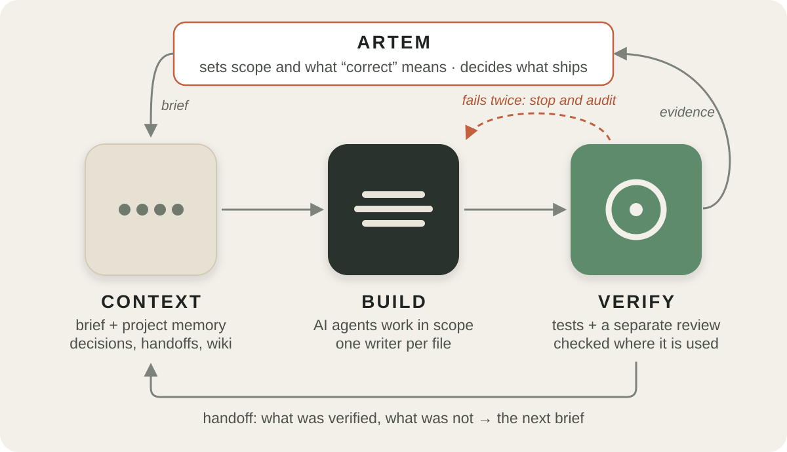

# How I Run AI Agents Like an Operations Team

*By [Artem Trofymenko](https://github.com/artemtrofymenko). I spent around 20 years running B2B businesses; I am not a software engineer by training. I build my own products ([ReadyCSV](https://www.readycsv.com), [SkuSum](https://skusum.com), [LeakRelay](https://www.leakrelay.com)) with AI agents, and this is how that work is organised. Revised 27 October 2026; numbers carry their dates.*

  

## Four ways agents fail you

I work with several agents every day: coding agents in the terminal, a desktop assistant, an always-on server agent, and chat tools. Used naively, they fail in four predictable ways:

1. **Amnesia.** Every session starts from zero, and Monday's decision gets argued again on Wednesday.
2. **Sprawl.** Each tool keeps its own notes, and two agents give you two different answers about what was decided.
3. **Confident false success.** The agent reports "done" from its own point of view: the file was written, the test passed, the setting was saved. Whether the thing that reads it sees the same is a separate question.
4. **Actions you did not mean.** An agent with a browser or a terminal is one confident click away from something you cannot take back.

None of this needed a custom orchestration codebase. It needed an operating discipline, written into a few small, boring systems.

## The setup

| Part | Does | Does not |
|---|---|---|
| **Me** | Set the scope and what "correct" means; approve anything that cannot be undone: publishing, sending, spending | Approve every reversible step, which would turn approval into rubber-stamping |
| **Claude Code and Codex** | Write code and project files, one writer per file; one reviews the other's work where it matters | Push, publish or deploy without my approval |
| **Desktop Hermes** | Research, inspection and task briefs on my machine | Edit code repositories |
| **Server Hermes** | Scheduled jobs and reports on a VPS, driven over Telegram; maintains the wiki through staged, linted jobs | Edit code repositories |
| **artem-memory** | Project state, decisions and handoffs, read and written by the agents through MCP | Hold transcripts or secrets |
| **Artem Wiki** | Sources, synthesised knowledge and runbooks, in a private Git repository | Sync itself with memory: anything moved between them is moved on purpose |

The rule for every agent: read the project brief before working, and finish with a handoff that separates **verified** from **not verified** and lists changed files and the rollback. Models: Claude Code and Codex use their providers' own clients; Hermes runs on OpenAI with OpenRouter configured as a fallback.

## Rules, and the incidents behind them

**Written is not in effect.** An edit script printed success, and I believed it. The scheduler that read the file disagreed: backticks in a here-document had been expanded by the remote shell, splicing a helper's output into the field where a path belonged. It was the fourth time the same class of failure had bitten me. Since then, a check reads the value back from where the consumer reads it, never from where it was written. And when the same approach fails twice, the agent must stop, write down what it believes, mark each belief as observed or assumed, and test the cheapest assumption before trying anything else.

**A test counts only after you have seen it fail.** In my open-source work every new test is shown failing against the old code, and the feature it guards is broken on purpose to prove the test notices. A test that has never been red is a test of nothing. That method is behind [45+ merged pull requests](https://github.com/career-ops-hq/career-ops/pulls?q=is%3Apr+author%3Aartemtrofymenko+is%3Amerged) in [career-ops](https://github.com/career-ops-hq/career-ops), a project I contribute to and did not create.

**Check where the result lands.** One job aggregator returned "Anywhere in the World" as the location for all 24 of its postings in my backlog, which quietly turned my location filter into a no-op for that source. I checked four against the employers' own job boards: all four were United States only. The field was filled in, the pipeline was green, and the data was wrong in the direction that cost the most.

**Approval sits where irreversibility lives, and tools do not grant authority.** Agents prepare: drafts, fixes, application packs, messages. Publishing, sending and spending are mine. An agent that has a browser or a terminal still has no authority to act through it, and approving every reversible step instead would only teach me to rubber-stamp.

**Measure the divergence, not the score.** Every week the operation assesses its own output, and a separate judge scores the same period. The signal is the gap between the two. In August the self-assessment first ran optimistic, then over-corrected to 8.0 and 8.3 against a judge at 10.0, and the prompt was recalibrated with a target gap under 1.0.

**Assess the idea separately from the code.** I piloted four third-party frameworks in summer 2026, installed none and adopted two ideas. One pilot scored 4 of 6 on real queries against my wiki, where my own search scored 1 of 6. That was a diagnosis, not a reason to switch: fixing my query logic took my search to 5 of 6, ahead of a vector-search option that scored 3 of 6 on a small, bilingual, keyword-dense corpus.

## Two recent examples

**A ReadyCSV release, 27 October 2026.** ReadyCSV prepares CSV files for HubSpot import, processing them in the browser. One delimiter bug made an uneven row look valid by picking the wrong separator. A separate review reproduced the failure and required a regression test for it, and the release (`533010e`) went out after 192 unit and 64 end-to-end tests, then was checked on the live site with 10 regression and privacy checks.

**A 30-second film, made by a team of agents, 27 October 2026.** Every frame and every sound computed in JavaScript, with an open-source skill: 15 scene agents, a music agent and four critics who measured the frames in pixels. The critics found 2 blocking problems and about 20 smaller ones, fixed by the agents that owned those scenes, and a gate checked every frame for determinism and render cost. The delivery itself failed twice: the audio overshot its peak ceiling after two different fixes. The stop rule fired, and instead of a third variation the coordinating agent measured each stage and found the encoder overshooting on the very first beat. Four bugs in the skill's own tools turned up along the way, and the fixes went to its author as a [pull request](https://github.com/kuhnhomeuk-cell/procedural-film/pull/6).

## Scope and limits

This is one operator's setup for his own projects, not an enterprise deployment. Most rules are a working contract enforced by instructions and my review; a few are mechanical, such as a hook that injects the core rules at the start of every session. The memory, wiki and agent configuration are private. What you can check from outside: the products on their live sites, and the open-source work on GitHub.

## Lessons for operators starting today

- Start with the **handoff format**, not the tooling. One markdown file of structured handoffs beats a smarter agent with no memory.
- Add the **no-secrets rule on day one**. Retrofitting it is miserable.
- Give every project **one canonical name**. Naming drift is how shared memory quietly dies.
- Approve **only what is irreversible**. If you approve everything, you start rubber-stamping.
- **Verify from the consumer's side.** A success message from the thing that wrote the value proves nothing about the thing that reads it.

[LinkedIn](https://www.linkedin.com/in/trofymenko-artem/) · [GitHub](https://github.com/artemtrofymenko) · [Open-source record](https://artemtrofymenko.github.io/open-source-record/)
